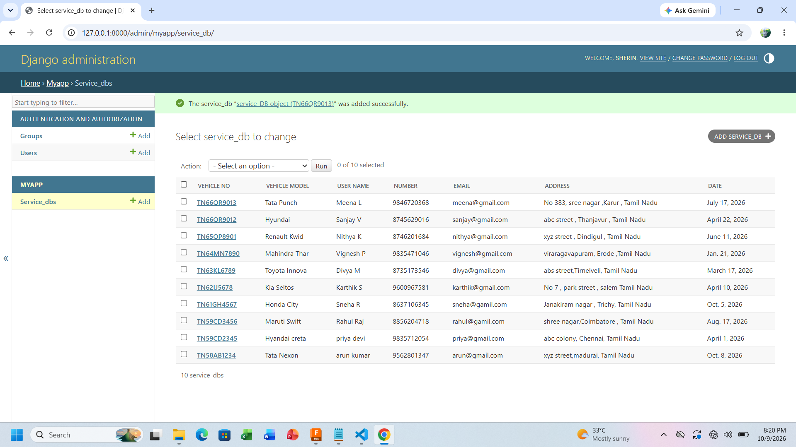

# Ex02 Django ORM Web Application
## Date: 12.10.2026

## AIM
To develop a Django Application to store and retrieve data from a Vehicle Service Database platform using Object Relational Mapping(ORM).


## DESIGN STEPS

### STEP 1:
Clone the problem from GitHub

### STEP 2:
Create a new app in Django project

### STEP 3:
Enter the code for admin.py and models.py

### STEP 4:
Detect changes and create migration files that describe how to modify the database schema

### STEP 5:
Execute the migration files and update the database schema to match your Django models

### STEP 6:
Create a superuser with full access rights to all models and data through the admin interface.

### STEP 7:
Apply the migration files of the created app to the database

### STEP 8:
Execute Django admin using localhost and create details for 10 entries

## PROGRAM
```
model.py

from django.db import models
from django.contrib import admin 
class service_DB(models.Model):
    Vehicle_No=models.CharField(primary_key=True)
    vehicle_model=models.CharField()
    user_Name=models.CharField(max_length=20)
    Number=models.IntegerField()
    Email=models.EmailField()
    Address=models.TextField()
    Date=models.DateField()
class service_DBAdmin(admin.ModelAdmin):
    list_display=["Vehicle_No","vehicle_model","user_Name","Number","Email","Address","Date"]

admin.py
from django.contrib import admin
from .models import service_DB,service_DBAdmin
admin.site.register(service_DB,service_DBAdmin)
```


## OUTPUT



## RESULT
Thus the program for creating Vehicle Service Delivery Database using ORM hass been executed successfully